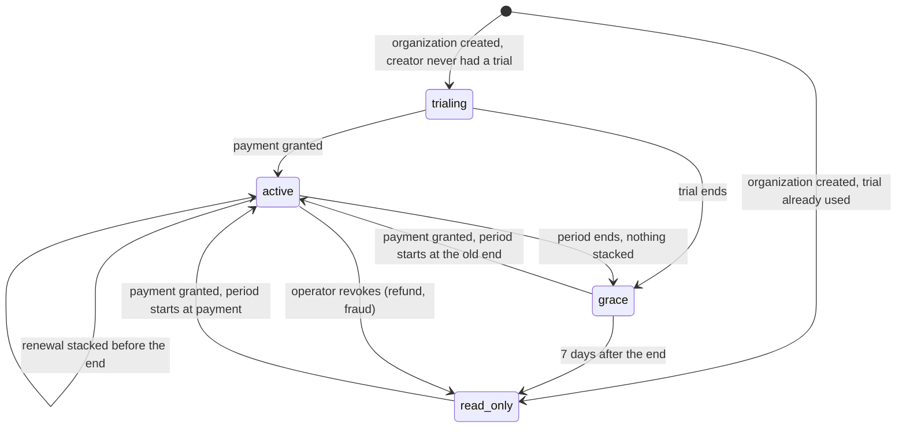
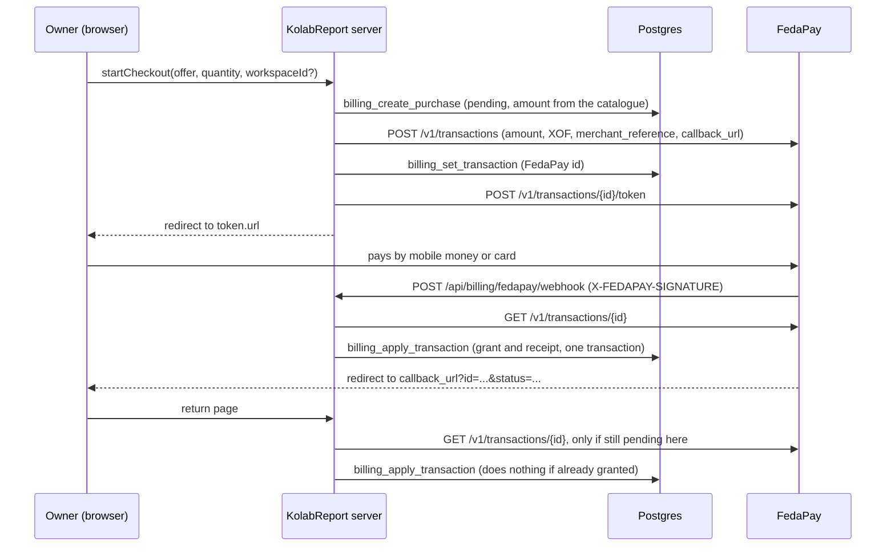

# 001. Billing per organization, paid through FedaPay

- Status: Proposed, 2026-10-14
- Jira: KRB-174 (Story 7.1), epic KRB-173 "Subscriptions & Billing (FedaPay)"
- Decides: Mocktar Tairou (product owner), after review of this document
- Implementation plan: [001-billing-and-fedapay-plan.md](001-billing-and-fedapay-plan.md)
- Draft schema, for illustration only: [001-billing-schema-draft.sql](001-billing-schema-draft.sql)

This ADR fixes how KolabReport charges firms: what is billed, how limits are counted and enforced, how a FedaPay payment turns into a period of access, and what receipts look like. Nothing here is implemented yet. Section 17 lists what the product owner and the accountant still have to answer.

## Contents

1. [Context](#1-context)
2. [Decision summary](#2-decision-summary)
3. [Billing unit and counting rules](#3-billing-unit-and-counting-rules)
4. [Plan catalogue](#4-plan-catalogue)
5. [Data model](#5-data-model)
6. [State machine and period rules](#6-state-machine-and-period-rules)
7. [Enforcement points](#7-enforcement-points)
8. [Payment flow](#8-payment-flow)
9. [Receipts](#9-receipts)
10. [Existing organizations at launch](#10-existing-organizations-at-launch)
11. [Security and abuse](#11-security-and-abuse)
12. [Observability](#12-observability)
13. [Testing strategy](#13-testing-strategy)
14. [FedaPay facts and sources](#14-fedapay-facts-and-sources)
15. [Consequences](#15-consequences)
16. [Alternatives considered](#16-alternatives-considered)
17. [Open questions](#17-open-questions)

## 1. Context

### Business model (decided by the product owner)

Paid per firm, in FCFA (XOF), through FedaPay (mobile money and cards). Readers are free on every plan. Prices are excluding tax (HT).

| Offer | Price HT | Includes |
| --- | --- | --- |
| Free trial | 14 days, no card | 1 report, 5 members, 20 AI drafts |
| Indépendant | 15 000 FCFA a month | 3 members, 3 active reports, 60 AI drafts a month |
| Cabinet | 49 000 FCFA a month | 10 members, unlimited reports, 250 AI drafts a month, custom prompt templates |
| Institution | quote, from 150 000 FCFA a month, yearly, bank transfer | unlimited members, larger AI quota, onboarding |
| Pass Mission | 39 000 FCFA per report, 90 days | 10 members, 80 AI drafts |
| Pack IA | 12 000 FCFA per 100 drafts | on top of any plan |

- Periods are prepaid: a month, a quarter or a year. A year costs 10 months. There is no automatic debit: we send reminders 7 days before the end, 1 day before, and on the day it ends.
- When a period ends: 7 days of grace, then read-only. Reading and exporting still work, writing does not.
- Customers buy AI drafts (section drafts), not tokens. The monthly token budget per workspace (`AI_MONTHLY_TOKEN_BUDGET`, checked in `start_ai_generation`) stays as the cost cap.
- Seller: Mocktar Technologies (Benin). FedaPay sandbox on staging (kolabreport.mocktar.com), live account on production.
- Tax: VAT and normalized invoices (e-MECeF) wait for the accountant. The design has to take tax lines and an external invoice number later without a rewrite.

### What the code does today

Read on master at `22f87bc`:

- **Tenancy.** `organizations` is the firm (wizard copy: "Le cabinet ou l'entreprise qui produit les rapports"). A `workspace` belongs to one organization and is one client engagement ("Un espace par client ou par mission"). Reports, sections, deliverables, invitations, AI generations and notifications all carry `workspace_id`. Roles (`owner`, `admin`, `expert`, `viewer`) live on `workspace_members`. There is no organization role table: `private.is_organization_member` is "owns the organization or belongs to one of its workspaces".
- **The wizard creates a new organization every time.** `public.create_workspace_with_owner(organization_name, workspace_name, report_title)` inserts an organization, a workspace and a first report in one transaction (migration `20261013150000_workspace_rbac.sql`). The UI has no way to add a workspace to an existing organization, although the RLS insert policy on `workspaces` allows it. In practice one organization holds one workspace.
- **No "new report" action.** The only report a user can create from the UI is the wizard's first report. The `reports: managers create` policy and the column grant allow direct inserts, nothing in `src/` uses them.
- **People join only through invitations** (`20261014130000_close_cross_tenant_writes.sql`): `accept_workspace_invitation` and `accept_my_pending_invitations`, both through `private.join_from_invitation`. Invitations are inserted directly through PostgREST under RLS (`src/app/[locale]/(app)/espaces/[workspaceId]/membres/actions.ts`).
- **Report statuses** are `draft`, `in_review` and `final` (KRB-20). There is no archived status. A final report is frozen until an owner reopens it (`final` to `draft`). `workspaces.archived_at` exists and changes nothing.
- **AI drafts** (`20261013220000_ai_generations.sql`, redefined in `20261014000000_ai_observability_rollouts.sql`): `start_ai_generation` runs with the service role, takes advisory locks per user then per workspace, applies 30 requests an hour per user (failures included) and 2 000 000 tokens a month per workspace (calendar month, UTC), then inserts a `running` row. The route records `succeeded` or `failed` later with the service role. A run older than 10 minutes is marked `stale`. Accept and discard go through `accept_ai_generation` and `discard_ai_generation`. Generations survive their section but are deleted with their workspace.
- **Security audit finding F-05** (`docs/security/audit-2026-10.md`): the budget is per workspace and workspaces are free and unlimited, so a user gets a fresh budget with each new workspace. Billing has to close this.
- **Scheduled jobs**: Vercel Cron calls `/api/cron/storage-cleanup` once a day with `Authorization: Bearer $CRON_SECRET` (`src/lib/cron.ts`). Vercel runs crons on the production deployment only.
- **E-mail**: `sendEmail` in `src/lib/email/send.ts` (Brevo, Resend or Mailpit), no attachments.
- **Exports**: PDFs are drawn with `@react-pdf/renderer` and the standard Helvetica font through `toWinAnsi` (`src/lib/export/`).
- **CSP** (`next.config.mjs`): `script-src 'self' 'unsafe-inline'`, `connect-src` limited to this origin and Supabase, `form-action 'self'`.
- **Middleware** (`src/middleware.ts`) skips `/api`, and sends signed-out visitors to `/fr/connexion` from every page that is not in `PUBLIC_PATHS`.

## 2. Decision summary

1. **The organization (the firm) is the billing unit**, as the coordinator proposed. Limits count across all the organization's workspaces. For that to hold, the wizard must let a user add a workspace to an organization they already manage, and a workspace needs a "Nouveau rapport" action (section 3.2).
2. **A Pass Mission covers one workspace** (one engagement) holding one report, for 90 days. Each workspace is either covered by the organization's subscription or by its own passes (`workspaces.billing_mode`).
3. **Counting rules**: a member is a distinct e-mail address with a non-viewer role in a covered workspace, open invitations included. An active report is a `draft` or `in_review` report. An AI draft counts when it succeeds, reserved at start and released if it fails.
4. **Entitlements, not subscriptions.** Every right is a row in `billing_entitlements` with its own dates and a copy of its limits. The state (trialing, active, grace, read-only) is computed from dates at the moment of the check, never stored. A cron that misses a day changes nothing about access.
5. **The database guarantees the limits.** Checks run inside triggers and SECURITY DEFINER functions under one advisory lock per organization. The app checks first for nicer messages, the database has the last word.
6. **FedaPay redirect flow with plain `fetch`**, no Checkout.js widget and no SDK. The server computes the amount from the catalogue in code, stores a pending purchase, creates the FedaPay transaction with our purchase id as `merchant_reference`, and redirects to the FedaPay payment page.
7. **Nothing is granted from a request body.** The webhook checks the signature, then the server re-reads the transaction from the FedaPay API and grants in one database transaction that is safe to run twice. The return page and a reconciliation job use the same function.
8. **Receipts** get a gapless number per seller and year (`KR-2026-000001`), keep a frozen copy of the seller, buyer and lines, have tax columns at zero for now, and an empty slot for an external (e-MECeF) invoice number. The PDF is drawn on demand from those rows.
9. **Existing organizations** get a 30-day launch period with Cabinet limits from the launch date. Their owners count as having used their trial.
10. **Enforcement ships dark.** A single switch (`private.billing_settings.enforced`) stays off until the launch migration, so each story can merge on its own.

## 3. Billing unit and counting rules

### 3.1 Organization, not workspace

The product owner said "per workspace (the firm)". In the schema those are two different things, and the firm is the organization:

- The wizard describes the organization as the firm and the workspace as one client or mission. A firm with five clients has five workspaces.
- Billing per workspace would charge a firm once per client engagement. Cabinet (10 members, unlimited reports, 250 drafts a month) only makes sense across engagements.
- An expert who works on three engagements of the same firm is one person for the firm. Counting distinct people across workspaces matches "per firm".
- F-05 is about free budgets per workspace. Counting AI drafts per organization closes it, as long as a new organization does not hand out a new trial (section 11).

The product UI blurs the two words today: the dashboard empty state says "Un espace de travail regroupe votre organisation, ses rapports et les experts qui les rédigent". Billing screens should say "organisation (cabinet)" and name the organization, so customers know what they pay for.

### 3.2 What has to change for organization billing to work

Without these two changes, "per organization" is "per workspace" in practice, and every new engagement opens a new organization with a new trial:

1. **Add a workspace to an existing organization.** The wizard's first step lists the organizations where the user is the owner (`organizations.owner_id`) or an owner or admin of one of its workspaces, and selects the one of the current workspace by default. "Nouvelle organisation" stays available. A new function `public.create_workspace_in_organization(organization_id, workspace_name, report_title)` does the insert with the same checks as the RLS policy, plus the billing checks of section 7.
2. **Create a report inside a workspace.** A "Nouveau rapport" button for owners and admins on the dashboard, backed by a server action that inserts with the user's client (RLS and the billing trigger apply).

Both belong in KRB-175 as its first pull request. If the product owner prefers, they can become their own story placed before KRB-175.

### 3.3 Two kinds of workspace

`workspaces.billing_mode` takes one of two values:

- `subscription` (default): covered by the organization's subscription line (trial, Indépendant, Cabinet, Institution, launch period). Its reports, members and drafts count against that line.
- `mission`: covered only by Pass Mission entitlements attached to this workspace. Its reports, members and drafts never count against the subscription. Without a pass running or in grace, it is read-only, even when the organization has an active plan.

The column is set by the server only: by `create_workspace_in_organization` when the user starts a new mission under a pass, and by the grant function when a pass is paid for an existing workspace. Users keep their current column grant on `workspaces` (`name`, `description`, `archived_at`), so they cannot change it. Moving a mission workspace back under the subscription is a later action ("Rattacher à l'abonnement"), subject to the subscription's limits.

### 3.4 Exact counting rules

The **covered workspaces** of an entitlement are: for the subscription line, every workspace of the organization with `billing_mode = 'subscription'`; for a pass, its own workspace.

**Member.** A distinct e-mail address (lower case) that holds the role `owner`, `admin` or `expert` in at least one covered workspace, either:

- as a member: a `workspace_members` row joined to `auth.users.email`, or
- as an open invitation: a `workspace_invitations` row with `accepted_at` and `revoked_at` null and `expires_at` in the future.

Viewers never count, as members or as invitations, and there is no viewer limit. The same person in three workspaces counts once. The organization owner counts through their memberships, like everyone else. Open invitations count because accepting one must not fail on a limit the inviter could not see: the seat is reserved when the invitation is sent, freed when it is revoked or expires. Pending invitations show as such in the usage meter ("2 membres + 1 invitation sur 3").

Changes that add a member: sending an invitation with a non-viewer role, resending an expired one (it becomes open again), changing a viewer to expert, admin or owner, accepting an invitation (checked again, see 7.1), creating a workspace (the creator becomes owner). Changes that free a seat: revoking an invitation, letting it expire, removing a member, a member leaving, changing a role to viewer.

**Active report.** A report with status `draft` or `in_review` in a covered workspace of the subscription line. `final` reports do not count: they are frozen. Reopening a final report (`final` to `draft`) takes a slot again and is refused when none is free. Deleting a report frees its slot. `archived_at` has no effect today, so reports of an archived workspace still count; if archiving ever freezes a workspace, its reports stop counting.

In a `mission` workspace the rule is simpler: the workspace holds one report, whatever its status. A pass is sold "per report", so finalizing the report does not open room for a second one. Another mission means another workspace and another pass.

**AI draft.** One `ai_generations` row that reaches `succeeded`. In detail:

1. `start_ai_generation` reserves one unit in the same locked step that already applies the hourly limit and the token budget. Reservations count against the allowance, so two parallel requests can never both take the last unit.
2. When the route records `succeeded`, the unit is counted. When it records `failed` (provider error, invalid output, abort, timeout, crash, or the 10-minute `stale` rule), the unit is released.
3. Accepting or discarding the proposal changes nothing.

Why on success: the customer pays for a draft they received. Failures are on our side, so charging them would be unfair. Counting on accept would make drafts free for anyone who reads the proposal, copies it and discards it.

The ledger of counted drafts lives in its own table keyed by organization (`billing_draft_usage`), not in `ai_generations`, because generations are deleted with their workspace and a manager could otherwise reset the count by deleting a scratch workspace.

**Where a draft is counted**, in this order:

1. The allowance of the entitlement covering the workspace: per calendar month (UTC, the same month as the token budget) for Indépendant, Cabinet and Institution; for the whole entitlement for the trial (20) and a pass (80). The monthly count is per organization and per month, whatever the entitlement row, so renewing or upgrading in the middle of a month does not open a second allowance for that month.
2. When that is used up, the organization's Pack IA credits, oldest expiry first. Packs work in every workspace of the organization, mission workspaces included.
3. When nothing is left, the request is refused before any model call.

**Custom prompt templates.** Creating, editing, publishing or rolling out a workspace template (`prompt_library.workspace_id` not null), and starting a draft with one, need an entitlement with `custom_templates`. Global templates stay available on every plan. Templates made under Cabinet are kept when the organization moves to Indépendant, hidden from drafts until it moves back.

**Downgrades and over-limit states.** Limits gate what is added, never what exists. An organization over its limits after a downgrade keeps every member and report, and cannot add more until it is back under. A grant after payment never fails because of a limit.

### 3.5 Who sees and pays

There is no organization role table, so billing rights come from workspace roles:

| Right | Who | Helper |
| --- | --- | --- |
| Read the billing page, usage, purchases, receipts | `organizations.owner_id`, and every owner or admin of a workspace of the organization | `private.can_read_org_billing(org)` |
| Buy, edit billing details | `organizations.owner_id`, and every owner of a workspace of the organization | `private.can_manage_org_billing(org)` |
| See that their workspace is in grace or read-only, and why | every member of the workspace | `public.workspace_billing_state(ws)` returns state and dates, no amounts |

Reminder e-mails go to the people who can buy.

## 4. Plan catalogue

The catalogue is TypeScript constants in `src/lib/billing/catalog.ts`, with a `CATALOG_VERSION` number. It is the only place with prices. The server computes every amount from it. When an entitlement is granted, its limits are copied into the entitlement row, so a price or limit change never touches a period already paid, and an Institution deal can carry custom limits.

The trial is created by the database when an organization is inserted, so its terms also live in one SQL function, `private.billing_trial_terms()`, mirrored in the catalogue. A unit test reads the SQL file and a pgTAP test reads the function, so the two cannot drift silently (same approach as `private.report_status_transitions` and `src/lib/reports/status.ts`).

### Offers

| Offer code | Plan | Price HT (FCFA) | Length |
| --- | --- | --- | --- |
| `independant_1m` | Indépendant | 15 000 | 1 month |
| `independant_3m` | Indépendant | 45 000 | 3 months |
| `independant_12m` | Indépendant | 150 000 | 12 months (10 paid) |
| `cabinet_1m` | Cabinet | 49 000 | 1 month |
| `cabinet_3m` | Cabinet | 147 000 | 3 months |
| `cabinet_12m` | Cabinet | 490 000 | 12 months (10 paid) |
| `mission_pass` | Pass Mission | 39 000 | 90 days |
| `ai_pack_100` | Pack IA | 12 000 per pack, 1 to 10 packs | 100 drafts per pack, valid 12 months |
| none (manual) | Institution | quote, from 150 000 a month | usually 12 months, set by hand |

The quarter has no discount: the brief only discounts the year. A month is a calendar month from the start time (Postgres `interval '1 month'`).

### Limits per plan

| Plan | Members (non-viewers) | Reports | AI drafts | Custom templates |
| --- | --- | --- | --- | --- |
| Trial, 14 days | 5 | 1 active | 20 for the whole trial | yes (to confirm, Q5) |
| Indépendant | 3 | 3 active | 60 a month | no |
| Cabinet | 10 | no limit | 250 a month | yes |
| Institution | no limit | no limit | per contract, default 1 000 a month (Q12) | yes |
| Pass Mission | 10, in its workspace | 1, in its workspace | 80 for the pass | no |
| Pack IA | | | 100 per pack, after the plan's allowance | |

## 5. Data model

### 5.1 Overview

Billing data belongs to the organization, not to one workspace, so the billing tables carry `organization_id` instead of `workspace_id`. Rows that belong to one workspace (passes, draft usage) carry both. This is a deliberate reading of the project rule "every tenant table has `workspace_id` and RLS": the rule is there so every row is scoped to a tenant and protected by RLS, and `organization_id` does that here, with RLS and policies in the same migration. KRB-175 should update the rule in `CLAUDE.md` to "`workspace_id` or `organization_id`" (I have not changed `CLAUDE.md` in this story).

Internal tables that users never read go in the `private` schema, which the API does not expose (same as `private.storage_cleanup_queue`).

| Table | Schema | Scoped by | Users read | Users write |
| --- | --- | --- | --- | --- |
| `workspaces.billing_mode` (new column) | public | workspace | members (existing policy) | no |
| `organization_billing` | public | organization | billing readers | billing managers, 4 columns |
| `billing_entitlements` | public | organization, workspace for passes | billing readers | no |
| `billing_ai_packs` | public | organization | billing readers | no |
| `billing_draft_usage` | public | organization, workspace | billing readers | no |
| `billing_purchases` | public | organization, workspace for passes | billing readers | no |
| `billing_receipts`, `billing_receipt_lines` | public | organization | billing readers | no |
| `billing_settings` | private | global | no | no |
| `billing_trial_claims` | private | user | no | no |
| `billing_payment_events` | private | purchase | no | no |
| `billing_events` (audit) | private | organization | no | no |
| `billing_notices` | private | entitlement | no | no |
| `billing_receipt_counters` | private | seller and year | no | no |

"No" in the last column means no INSERT, UPDATE or DELETE grant to `authenticated` at all. Every write goes through a SECURITY DEFINER function (user context, rights checked with `auth.uid()`) or through a function granted to `service_role` only.

### 5.2 Tables

Full column lists, constraints and indexes are in [001-billing-schema-draft.sql](001-billing-schema-draft.sql). The important points:

**`private.billing_settings`** (one row): `enforced boolean default false`, `launched_at`, and `seller jsonb` (name, address, IFU, RCCM, e-mail of Mocktar Technologies, copied into each receipt). While `enforced` is false every check passes, so stories can merge before launch.

**`public.organization_billing`** (one row per organization, created by a trigger on `organizations`): `legal_name`, `address`, `tax_id` (IFU), `billing_email`. Copied into receipts. Managers update these four columns through a column grant and an update policy.

**`public.billing_entitlements`**: one row per right over time.

- `organization_id` (cascade), `workspace_id` (cascade, set for passes only), `scope` (`subscription` or `mission`), `plan` (`trial`, `independant`, `cabinet`, `institution`, `mission`), `source` (`trial`, `purchase`, `manual`, `launch`).
- `starts_at`, `ends_at`, `grace_days` (default 7).
- Copied limits: `max_members`, `max_reports`, `drafts_per_month`, `drafts_total`, `custom_templates`. Null means no limit.
- `purchase_id`, `amount_ht_xof` (what this period cost, used to convert unused days on upgrade), `note`, `revoked_at`, `revoked_reason`.
- Exclusion constraints (extension `btree_gist`): two non-revoked `subscription` rows of an organization never overlap in time, and two non-revoked `mission` rows of a workspace never overlap. At any instant there is at most one subscription entitlement per organization and one pass per workspace, which makes "the current entitlement" a single row and stacking errors impossible to store.

**`public.billing_ai_packs`**: `organization_id`, `purchase_id`, `drafts` (100 per pack), `expires_at` (purchase + 12 months), `revoked_at`.

**`public.billing_draft_usage`**: the draft ledger. `generation_id` (primary key, no foreign key: the generation may go with its workspace, the usage stays), `organization_id` (cascade), `workspace_id` (set null), `pool` (`subscription`, `trial`, `mission`, `pack`), `entitlement_id`, `pack_id`, `usage_month` (first day of the UTC month), `status` (`reserved`, `counted`, `released`), `created_at`, `settled_at`. Partial indexes on `(organization_id, usage_month)`, `(entitlement_id)` and `(pack_id)` where `status <> 'released'`.

**`public.billing_purchases`**: one row per checkout attempt or manual payment.

- `organization_id` and `workspace_id`: `on delete set null`, because payments are accounting records that outlive the organization.
- `offer`, `offer_label` (French label frozen at creation, used on the receipt), `catalog_version`, `quantity`.
- `amount_ht_xof`, `tax_xof` (0 for now), `amount_xof` (check: equals the sum), `currency` (check: `XOF`).
- `method` (`fedapay`, `bank_transfer`, `manual`), `environment` (`sandbox`, `live`, `mock`, `manual`).
- `status`: `pending`, `paid`, `expired`, `refunded`, `review` (FedaPay says paid but something does not match, an operator decides).
- `merchant_reference` (unique, `KR-` plus the purchase id, sent to FedaPay), `fedapay_transaction_id` (unique with `environment`), `fedapay_status`, `fedapay_mode` (payment method), `fedapay_fees_xof`.
- `created_by`, `created_at`, `paid_at`, `granted_at`, `last_checked_at`, `confirmation_sent_at`.

**`private.billing_payment_events`**: status history of a purchase. `purchase_id`, `source` (`checkout`, `webhook`, `return`, `reconcile`, `manual`), `fedapay_event_id` (unique with `source` when present, so a webhook delivered twice is recorded once), `event_name`, `fedapay_status`, `amount_xof`, `received_at`. No raw payload: FedaPay events carry the customer's e-mail and phone number.

**`public.billing_receipts`** and **`public.billing_receipt_lines`**: section 9. Receipts reference their purchase with `on delete restrict`, their organization with `on delete set null`. A trigger refuses every update except `external_invoice_number`, `external_invoice_data` and the `organization_id` set to null by a deleted organization, and refuses every delete, service role included.

**`private.billing_trial_claims`**: `user_id` (primary key), `email_hash` (unique, SHA-256 of the confirmed e-mail in lower case), `organization_id`, `claimed_at`. The hash stops a deleted account from coming back with the same e-mail for a second trial, without keeping the address itself.

**`private.billing_events`**: audit log. `organization_id` (no foreign key, kept after deletion), `kind` (`trial_started`, `granted`, `converted`, `manual_grant`, `manual_revoke`, `refund_seen`, `review`, `launch_period`, `entered_grace`, `entered_read_only`), `actor` (operator name for manual changes, null for the system), `reason`, `details jsonb` (before and after), `created_at`.

**`private.billing_notices`**: `(entitlement_id, kind)` primary key, `kind` in `d7`, `d1`, `ended`, `read_only`. The cron inserts before sending, so a reminder goes out once.

**`private.billing_receipt_counters`**: `(seller, year)` primary key, `last_number`. Section 9.

### 5.3 Functions

Helpers in `private` (all `security definer`, `set search_path = ''`, `revoke all from public`):

| Function | Does |
| --- | --- |
| `can_read_org_billing(org)`, `can_manage_org_billing(org)` | rights of section 3.5 |
| `billing_lock_org(org)` | `pg_advisory_xact_lock` on `billing/org/<id>`. Always the last advisory lock a transaction takes |
| `billing_trial_terms()` | trial limits, mirrored in the catalogue |
| `workspace_access(ws, at)` | organization, mode, state (`active`, `grace`, `read_only`), the entitlement that applies and its limits. Returns `active` with no limits while `enforced` is false |
| `billing_check_seat(ws, email, include_invitations)` | raises `KR040` (or `KR041` at acceptance) |
| `billing_check_report_slot(ws)` | raises `KR042` |
| `assert_workspace_writable(ws)` | raises `KR043` in read-only |
| `billing_reserve_draft(ws, generation)` | picks the pool and inserts the reservation, or returns why not |
| `billing_issue_receipt(purchase)` | numbers and writes the receipt and its lines |

Functions in `public`:

| Function | Called by | Granted to |
| --- | --- | --- |
| `create_workspace_in_organization(org, workspace_name, report_title, mode)` | wizard | authenticated |
| `billing_overview(org)` | billing page, usage meter | authenticated (checks `can_read_org_billing`) |
| `workspace_billing_state(ws)` | app shell banner, members page, draft panel | authenticated (checks membership) |
| `billing_create_purchase(...)` | checkout server action | service_role |
| `billing_set_transaction(purchase, transaction_id)` | checkout server action | service_role |
| `billing_apply_transaction(...)` | webhook, return page, reconciliation | service_role |
| `billing_pending_purchases(limit)` | reconciliation | service_role |
| `billing_due_notices(at)` | daily cron | service_role |
| `billing_admin_grant(...)`, `billing_admin_revoke(...)`, `billing_admin_record_payment(...)` | operator script (Institution, corrections) | service_role |

`start_ai_generation` gets a new version (same arguments, the drop and create pattern of `20261014000000`): it calls `workspace_access` and `billing_reserve_draft` after the existing checks, and returns three new refusals, `readOnly`, `quotaExceeded` and `templateNotIncluded`. A trigger on `ai_generations` after an update of `status` moves the reservation to `counted` or `released`.

### 5.4 RLS and grants

Every public billing table has RLS enabled and its policies in the same migration:

- `select` to `authenticated` using `private.can_read_org_billing(organization_id)`. For `billing_receipt_lines`, through its receipt. Rows whose `organization_id` became null after a deletion are visible to nobody but the service role.
- `organization_billing`: `update` using and with check `private.can_manage_org_billing(organization_id)`, with a column grant on `legal_name`, `address`, `tax_id`, `billing_email` only.
- No other grant to `authenticated`. Nothing to `anon` (the default privileges from `20261013130000` already revoke it).
- `private` tables: RLS on, no policy, every privilege revoked from `public`, `anon`, `authenticated` and `service_role`. Only the definer functions touch them.

The service role keeps the Supabase default access to public tables, but the app only writes billing data through the functions above. The rule in `src/lib/supabase/admin.ts` becomes: scope every query by `workspace_id`, or by `organization_id` and the purchase id for billing.

### 5.5 How pgTAP tests it

New files under `supabase/tests/`, on the existing fixtures (`org_a` with `w1` and its five roles, `org_b` with `w2`):

- `billing_rls_test.sql`: owner and admin of `w1` read `org_a` billing rows; expert, viewer, outsider and stranger read none; nobody signed in can insert, update or delete any billing table, except the four columns of `organization_billing` for owners; `private` tables are unreachable; `anon` has no privilege (each privilege checked on its own, per F-12).
- `billing_limits_test.sql`: with `enforced` on and `org_a` on Indépendant: the fourth non-viewer invitation fails with `KR040`, a viewer invitation passes, revoking frees the seat, a viewer promoted to expert fails at the limit, acceptance after a downgrade fails with `KR041`; the fourth active report fails with `KR042`, finalizing one frees a slot, reopening fails when full; a mission workspace takes one report.
- `billing_drafts_test.sql`: `start_ai_generation` reserves, `succeeded` counts, `failed` and `stale` release; the 61st draft of the month is refused with `quotaExceeded` and a `retry_after` to the next month; a pack takes over; deleting the workspace keeps the ledger; templates refused on Indépendant.
- `billing_read_only_test.sql`: past the grace, section updates, deliverable inserts, invitations and status changes fail with `KR043`; deletes, leaving, revoking invitations, exports (`claim_report_export`) and marking notifications as read still work; the service role is not blocked.
- `billing_grant_test.sql`: applying the same approved transaction twice gives one entitlement and one receipt; a wrong amount or merchant reference gives `review` and no entitlement; early renewal stacks; renewal in grace starts at the old end; renewal after read-only starts now; upgrade converts unused days (the example of 6.3); downgrade starts at the end; a pass flips the workspace to `mission`; receipt numbers are consecutive per year with no gap after a rolled back grant.
- `billing_trial_test.sql`: the first organization of a user gets a trial; the second gets none; a deleted user coming back with the same e-mail gets none.

Concurrency cannot be shown in one pgTAP session. One Playwright test fires two invitations at the same time through two Supabase clients and checks that exactly one passes (section 13).

## 6. State machine and period rules

### 6.1 States

The state of a workspace is computed by `private.workspace_access` from the entitlements and the current time. It is never stored, so it is right even when the cron did not run.

| State | Meaning | Computed as |
| --- | --- | --- |
| `trialing` | trial running | an entitlement with `plan = 'trial'` covers now |
| `active` | paid, manual or launch period running | another entitlement covers now |
| `grace` | ended less than `grace_days` ago | no entitlement covers now, the last one ended less than 7 days ago |
| `read_only` | nothing running | anything else, including an organization that never had an entitlement |

`trialing` is `active` with the trial's limits, the UI just names it differently. A subscription workspace follows the organization's subscription line, a mission workspace follows its own passes. The grace keeps the rights and limits of the entitlement that ended.



### 6.2 What triggers a transition

| Trigger | Effect |
| --- | --- |
| Organization created (trigger on `organizations`) | trial entitlement if the creator has no trial claim, else nothing (read-only until a purchase) |
| Payment granted (`billing_apply_transaction`) | new entitlement or pack, dates from 6.3 |
| Time passing | nothing to write: the state is computed. The daily cron only sends reminders and writes `entered_grace` and `entered_read_only` audit events |
| Operator (`billing_admin_*`) | grant an Institution period with custom limits and dates, extend, revoke, correct. Each call needs an actor and a reason and writes `billing_events` |
| Refund seen at FedaPay | purchase `refunded`, audit event, alert. No automatic revoke: a refund can be a goodwill gesture, the operator decides |

### 6.3 Period rules

Each rule is one sentence a customer can read on the billing page.

| Situation | Rule | Start | End |
| --- | --- | --- | --- |
| Same plan, before the end | "Votre nouvelle période commence à la fin de la période en cours." | end of the last stacked period | start + length |
| During the grace | "Votre nouvelle période commence à la fin de la précédente." The grace days are not free, otherwise paying 7 days late every month would be a 23% discount. | end of the period that ended | start + length |
| Read-only | "Votre nouvelle période commence aujourd'hui." | payment time | start + length |
| During the trial | "Les jours d'essai restants s'ajoutent à votre première période." The trial ends at payment. | payment time | start + length + remaining trial days |
| Upgrade (Indépendant to Cabinet, Cabinet to Institution) | "Vos jours restants sont convertis en jours de la nouvelle offre." The current period ends at payment, periods stacked after it are revoked, their value becomes extra days. | payment time | start + length + extra days |
| Downgrade (Cabinet to Indépendant) | "La nouvelle offre commence à la fin de la période en cours." | end of the last stacked period | start + length |
| Launch period running | treated like a period worth 0 FCFA: buying the same plan or a lower one stacks after it, a higher plan converts nothing | as above | as above |
| Pass Mission | same rules per workspace: stacks on a running pass, starts at the old end in grace, now otherwise | as for plans | start + 90 days |
| Pack IA | no period | payment time | payment + 12 months |

Upgrade conversion, with no money moving and no refund:

```
credit_xof = sum over unused paid subscription periods of
               amount_ht_xof × (unused time / total time)     (1 for periods not started yet)
extra_days = floor(credit_xof × 30 / monthly price HT of the new plan)
```

Example: Indépendant bought on 1 November for 15 000 FCFA, upgrade to Cabinet (1 month) on 11 November. 20 of 30 days are unused: credit 10 000 FCFA. Cabinet costs 49 000 / 30 = 1 633 FCFA a day: 6 extra days. The Cabinet period runs from 11 November to 17 December. The ledger keeps the 11 November usage: drafts used under Indépendant that month still count against Cabinet's 250.

### 6.4 Institution, passes and packs

- **Institution** is never sold online. After the quote is signed and the bank transfer arrives, the operator runs `scripts/billing/record-payment.mjs` (KRB-179), which calls `billing_admin_record_payment` with the amount, the transfer reference, the dates and the limits. It creates a `paid` purchase with `method = 'bank_transfer'`, the entitlement and a numbered receipt, like an online payment. Renewal is the same script.
- **Passes** live in the `mission` scope. An organization can have a plan and passes, only passes, or nothing but a running pass: each workspace follows its own line.
- **Packs** are bought on top of a running or grace subscription or pass, not during the trial (Q6). They do not change the state.

## 7. Enforcement points

### 7.1 Where each limit is checked

The app checks first so it can explain the limit with numbers. The database checks again and wins. Every database check takes `private.billing_lock_org(org)` first, then counts, so two transactions for the same organization run one after the other.

| Limit | App check | Database check | Error |
| --- | --- | --- | --- |
| Members: invitation | `inviteMember` reads `workspace_billing_state` and shows the meter | `before insert` trigger on `workspace_invitations` when the role is not `viewer`: `billing_check_seat` | `KR040` |
| Members: resend | `resendInvitation` | `before update of expires_at, token_hash` on `workspace_invitations`, when the invitation had expired | `KR040` |
| Members: role change | `updateMemberRole` | `before update of role` on `workspace_members`, from `viewer` to another role | `KR040` |
| Members: acceptance | invitation page | `private.join_from_invitation` calls `billing_check_seat` counting members only (the invitation reserved the seat). `accept_my_pending_invitations` skips an invitation that fails and leaves it open | `KR041` |
| Members: new workspace | wizard | `create_workspace_in_organization` | `KR040` |
| Active reports: creation | "Nouveau rapport" action, wizard | `before insert` trigger on `reports`: `billing_check_report_slot`. The wizard path is covered because it inserts too | `KR042` |
| Active reports: reopening | `transitionReportStatus` | `before update of status` on `reports`, from `final` to another status | `KR042` |
| AI drafts | the draft panel shows what is left | `start_ai_generation`: `billing_reserve_draft` | refusal `quotaExceeded`, HTTP 402 |
| Custom templates | template pages hide the actions | `before insert or update` on `prompt_library` for workspace templates, `start_prompt_rollout`, and `start_ai_generation` | `KR044`, refusal `templateNotIncluded` |
| Read-only | banner, disabled buttons | section 7.3 | `KR043`, refusal `readOnly` |

An organization that never had an entitlement (the second organization of a user who used their trial, Q9) may still receive its first report, so `create_workspace_with_owner` can finish: the report trigger and the read-only guard let a report in when the organization has no entitlement row at all and no report yet. Everything else in that organization stays read-only until a purchase, and the wizard sends the user to the billing page.

Locks: `start_ai_generation` takes its user lock, then its workspace lock, then the organization lock. Every other billing path takes only the organization lock. The organization lock is always last, so no two paths wait on each other in opposite order.

Why advisory locks: the checks count rows across several tables (members, invitations, reports, the ledger). A row lock on one of them would not stop an insert in another. One lock per organization serializes exactly the transactions that can race. The cost is small: invitations and report creations are rare, and drafts already wait on the user and workspace locks.

### 7.2 Race example: two invitations at once

Two admins invite a third and a fourth expert on Indépendant (limit 3, two seats taken). Both inserts fire the trigger. The first takes the organization lock, counts 2, inserts, commits. The second waited on the lock; once it gets it, its count query takes a fresh snapshot (READ COMMITTED, a new statement in a volatile function), sees 3 and raises `KR040`. One invitation exists, one admin sees the limit message.

### 7.3 Read-only

What stops in read-only: every insert and update of content made in a user's name. What keeps working: reading, exporting, deleting, leaving, removing members, revoking invitations, marking notifications as read, rating a draft, discarding a draft, editing one's profile, and of course paying.

How:

- A trigger function `private.guard_billing_writable()` runs `before insert or update` on `report_sections`, `deliverables`, `prompt_library` (workspace templates) and `prompt_rollouts`, and `before update` on `reports`. It calls `assert_workspace_writable(new.workspace_id)` when `auth.uid()` is set, which covers both RLS writes and the definer functions users call (`save_section_content`, `accept_ai_generation`, `reorder_report_sections`), the same way `guard_final_report_sections` does today. Updates made by other triggers (`pg_trigger_depth() > 1`) are skipped, so removing a member still unassigns their sections. Report inserts and invitations (new or resent) make the same check inside their own billing triggers of 7.1, viewer invitations included.
- `transition_report_status` calls `assert_workspace_writable` itself: it writes `report_status_events` and `notifications`, which have no guard.
- `private.can_upload_deliverable` (storage policy) adds the check, so a file registered before the switch cannot land after it.
- Writes made with the service role (`auth.uid()` null) are not checked by the trigger: the parse worker, the export storage, `finishGeneration`, the billing jobs and the operator. Where the service role acts for a user, the function checks explicitly: `start_ai_generation` refuses with `readOnly`.
- Deletes are not blocked: they never add value, and blocking them would keep customer data hostage (deletion requests are also a GDPR right).

The check reads one entitlement row by organization or workspace, through an index. It runs once per written row, like the existing guards.

### 7.4 French messages

Proposed strings for `messages/fr.json`, in a new `Billing` namespace plus new keys in `Workspaces.errors` and `AiDraft.errors`. The database messages stay short, as today, and the app maps the codes to these keys with the numbers read from `workspace_billing_state`.

| Key | Text |
| --- | --- |
| `Workspaces.errors.seatLimit` (KR040) | Limite de membres atteinte : l'offre {plan} compte {max} membres, invitations en attente comprises. Annulez une invitation, retirez un membre ou invitez cette personne comme lecteur, les lecteurs sont gratuits. |
| `Workspaces.errors.seatLimitRole` (KR040) | Limite de membres atteinte : l'offre {plan} compte {max} membres. Cette personne peut rester lecteur, ou libérez une place. |
| `Workspaces.errors.seatLimitInvitee` (KR041) | L'organisation qui vous invite a atteint la limite de membres de son offre. Prévenez la personne qui vous a invité, puis rouvrez ce lien. |
| `Workspaces.errors.reportLimit` (KR042) | Limite de rapports actifs atteinte : l'offre {plan} en compte {max}. Passez un rapport en final ou supprimez-le, ou changez d'offre. |
| `Workspaces.errors.reportLimitReopen` (KR042) | Rouvrir ce rapport dépasserait la limite de {max} rapports actifs de l'offre {plan}. Passez d'abord un autre rapport en final. |
| `Workspaces.errors.missionReport` (KR042) | Un Pass Mission couvre un seul rapport. Créez un nouvel espace de travail pour une autre mission. |
| `Workspaces.errors.readOnly` (KR043) | Cet espace de travail est en lecture seule depuis le {date}. Vous pouvez consulter et exporter les rapports. Renouvelez l'offre pour les modifier. |
| `Workspaces.errors.readOnlyMember` (KR043, for experts and viewers) | Cet espace de travail est en lecture seule depuis le {date}. Demandez au propriétaire de l'organisation de renouveler l'offre. |
| `Workspaces.errors.templatesNotIncluded` (KR044) | Les modèles de prompt personnalisés sont inclus dans les offres Cabinet et Institution. |
| `AiDraft.errors.quotaExceeded` | Les {max} brouillons IA du mois sont utilisés. Ajoutez un Pack IA ou attendez le {date}. |
| `AiDraft.errors.quotaExceededTrial` | Les {max} brouillons IA de l'essai sont utilisés. Choisissez une offre pour continuer. |
| `AiDraft.errors.quotaExceededMission` | Les {max} brouillons IA de ce Pass Mission sont utilisés. Ajoutez un Pack IA pour continuer. |
| `AiDraft.errors.readOnly` | Cet espace de travail est en lecture seule : aucun brouillon ne peut être généré. |
| `AiDraft.errors.templateNotIncluded` | Ce modèle est un modèle personnalisé, inclus dans les offres Cabinet et Institution. Choisissez un modèle standard. |
| `Billing.banner.trial` | Essai gratuit : encore {days, plural, one {# jour} other {# jours}}. Choisissez une offre pour garder l'accès complet. |
| `Billing.banner.ending` | Votre offre {plan} se termine le {date}. Renouvelez-la pour éviter le passage en lecture seule. |
| `Billing.banner.grace` | Votre offre {plan} est terminée depuis le {date}. Tout reste accessible jusqu'au {graceEnd}, puis l'espace passera en lecture seule. |
| `Billing.banner.readOnly` | Lecture seule depuis le {date} : consultation et export uniquement. Renouvelez l'offre pour modifier vos rapports. |
| `Billing.banner.noPlan` | Cette organisation n'a pas encore d'offre. Choisissez-en une pour commencer à rédiger. |
| `Billing.checkout.unavailable` | Le paiement en ligne n'est pas disponible pour le moment. Réessayez plus tard. |
| `Billing.return.pending` | Paiement en attente de confirmation. Cette page se met à jour dès que FedaPay confirme le paiement. |
| `Billing.return.paid` | Paiement reçu. Votre offre {plan} est active jusqu'au {date}. Le reçu {number} est dans la liste des reçus. |
| `Billing.return.notPaid` | Le paiement n'a pas abouti. Vous pouvez réessayer, avec le même moyen de paiement ou un autre. |
| `Billing.return.expired` | Ce paiement a expiré. Lancez un nouveau paiement depuis la page Abonnement. |
| `Billing.email.d7.subject` | Votre offre KolabReport se termine dans 7 jours |
| `Billing.email.d1.subject` | Votre offre KolabReport se termine demain |
| `Billing.email.ended.subject` | Votre offre KolabReport est terminée |
| `Billing.email.paid.subject` | Paiement reçu, reçu {number} |

Dates are shown in the `Africa/Porto-Novo` time zone (UTC+1, no daylight saving). The monthly AI allowance resets at 00:00 UTC on the 1st, which is 01:00 in Cotonou.

## 8. Payment flow

### 8.1 Sequence



### 8.2 Checkout (server action `startCheckout`)

1. The user is signed in and `can_manage_org_billing(org)` is true. The form sends only the offer code, a quantity for packs and the workspace id for a pass. No amount comes from the client.
2. Zod checks the offer against the catalogue. The server checks the preconditions: a pass needs a workspace of this organization with at most one report; a pack needs a running or grace subscription or pass; an organization in `review` cannot buy (operator first).
3. If a `pending` purchase of the same organization and offer is less than 24 hours old and its FedaPay transaction is still `pending`, reuse it and ask a new token. This avoids two payments from two tabs.
4. Otherwise `billing_create_purchase` inserts the purchase with the amount from the catalogue, the frozen label and the environment. The `merchant_reference` is `KR-` plus the purchase id.
5. `POST /v1/transactions` with `description` ("KolabReport, offre Cabinet, 1 mois, <organization name>"), `amount`, `currency: { iso: "XOF" }`, `callback_url` (`<NEXT_PUBLIC_APP_URL>/fr/organisations/<org>/abonnement/retour/<purchase id>`, FedaPay adds `?id=&status=`), `merchant_reference`, `custom_metadata: { purchase_id }` and `customer` with the buyer's e-mail, first and last name. No phone number: the customer types it on the FedaPay page.
6. On a timeout or a network error, `GET /v1/transactions/merchant/{reference}` tells whether the transaction exists. FedaPay refuses a second transaction with the same `merchant_reference` (section 14), so a retry never creates two.
7. `billing_set_transaction` stores the FedaPay id, then `POST /v1/transactions/{id}/token` returns the payment `url`, and the action redirects to it. Once the page is hydrated, Next.js follows an external redirect from a server action with a client-side navigation, which the CSP `form-action 'self'` should not block. Item 2 of the sandbox checklist (13) confirms it; if a browser blocks it, add the payment page's origin to `form-action` (8.9).

### 8.3 Return page

`/fr/organisations/[organizationId]/abonnement/retour/[purchaseId]`, dynamic, behind sign-in (the middleware sends a signed-out user to `/fr/connexion?next=...`).

- It reads the purchase with the user's client (RLS) and ignores the `id` and `status` query parameters for anything but picking the first message. The transaction id comes from the purchase row.
- If the purchase is still `pending` and was not checked in the last 10 seconds, it re-reads the transaction and calls `billing_apply_transaction`. Then it shows the result, and refreshes every 5 seconds for 2 minutes while pending.
- The service worker must not answer this route from its cache (network only for `/abonnement`).

### 8.4 Webhook (`POST /api/billing/fedapay/webhook`)

Route handler, Node.js runtime, wrapped in `withRequestId`. The middleware skips `/api`.

1. Read the raw body as text, at most 100 KB.
2. Check `X-FEDAPAY-SIGNATURE`: it has the form `t=<unix time>,s=<hex>`. Compute HMAC-SHA256 of `<t>.<raw body>` with `FEDAPAY_WEBHOOK_SECRET`, compare with each `s` in constant time, refuse a timestamp more than 300 seconds old or ahead. This is the algorithm of FedaPay's Node SDK, written in our code (`src/lib/billing/webhook-signature.ts`). Failure: 400 and a `warn` log, no body logged.
3. Parse the JSON. Keep `transaction.*` events, answer 200 to others. Read the transaction id from `entity.id`, else `object_id`.
4. Find the purchase by `(environment, fedapay_transaction_id)`. Unknown: 200 and an `info` log. The FedaPay account may serve other products.
5. Re-read the transaction with `GET /v1/transactions/{id}` and our secret key. The status, amount and reference used below come from this answer only.
6. Call `billing_apply_transaction` with the event id, so a delivery seen twice is recorded once.
7. Answer 200 after the commit. If the FedaPay call or the database fails, answer 500: FedaPay retries up to 9 times, and the reconciliation catches the rest.

FedaPay's guide suggests answering 2xx before processing. We process first because a function on Vercel is not guaranteed to keep running after its answer, and the work is short (one API call, one database transaction, under 2 seconds). If it gets slower, answer 200 and move the work to `after()`, relying on the reconciliation for failures.

### 8.5 Grant: `billing_apply_transaction`

Service role only. One database transaction:

1. Lock the purchase row (`for update`). Insert the payment event, ignoring a duplicate event id.
2. Store `fedapay_status`, `fedapay_mode`, `fedapay_fees_xof`, `last_checked_at`.
3. If the status is `approved` or `transferred`:
   - already granted: return `already_granted`;
   - FedaPay amount differs from `amount_xof`, the `merchant_reference` differs, or the environment differs: status `review`, audit event, return `review` (alert, no grant);
   - otherwise take the organization lock, compute the dates (6.3), insert the entitlement or the pack, set the workspace to `mission` for a pass, mark the purchase `paid` with `paid_at` and `granted_at`, issue the receipt, write the audit event, return `granted` with the receipt number.
4. If the status is `refunded` or contains `refunded`: purchase `refunded` (if it was paid), audit event, return `refunded` (alert).
5. If `expired`: purchase `expired` unless paid.
6. If `declined` or `canceled`: record it and keep the purchase `pending`. FedaPay says these are not final: the customer can try again on the same transaction until it expires after 24 hours.
7. `pending`: nothing else.

After the commit the server sends the confirmation e-mail once (`confirmation_sent_at`).

### 8.6 Failure, cancel and refund paths

| Case | What happens |
| --- | --- |
| Customer cancels or the payment is declined | Return page shows `Billing.return.notPaid` with a "Réessayer" button that asks a new token for the same transaction while it is pending |
| Customer closes the tab after paying | The webhook grants. The next visit to the billing page shows the plan and the receipt |
| Webhook lost or endpoint down | The return page grants. If the customer never comes back, the reconciliation grants |
| Payment approved after the purchase was marked expired | The grant still happens: money received always grants. Audit event and alert |
| Amount or reference mismatch | `review`, no grant, alert. The operator checks in the FedaPay dashboard, then grants by hand or refunds |
| Refund | Done by the operator in the FedaPay dashboard (MTN Mobile Money only, per FedaPay). KolabReport sees `refunded`, alerts, and the operator revokes or shortens the entitlement with `billing_admin_revoke` and issues a credit note (Q10) |
| Two purchases paid for the same thing | Both grant and stack. Alert, so the operator can offer a refund |

### 8.7 Reconciliation

`reconcilePendingPurchases(limit)` in `src/lib/billing/reconcile.ts` takes purchases that are `pending`, younger than 3 days and not checked in the last 10 minutes (`billing_pending_purchases`), re-reads each transaction and applies it. Purchases without a FedaPay id are looked up by merchant reference. Purchases still pending after 48 hours become `expired` (FedaPay expires them after 24 hours).

It runs from:

- the return page, for its purchase;
- the billing page, for the organization's pending purchases, at most once a minute;
- the daily cron `/api/cron/billing`, for all of them.

On Vercel Pro the cron can run every hour. On Hobby it runs once a day, and the first two paths cover the customer who is waiting.

### 8.8 SDK or `fetch`

We call the API with `fetch` in a small client (`src/lib/billing/fedapay.ts`, about 150 lines: create, token, retrieve, retrieve by merchant reference). Reasons:

- The `fedapay` package (1.2.5) keeps the key and the environment in static globals (`FedaPay.setApiKey`, `FedaPay.setEnvironment`), which is fragile in a server that may run tests with several configurations.
- It pulls in `axios` 0.28 and bundles its own CA certificate file. Our other providers (Brevo, Resend) use `fetch`, with `AbortSignal.timeout`.
- We only need four calls and the signature check, all short and testable with a mocked `fetch`.

The client reads answers defensively: the SDK's test fixtures show objects wrapped under a `v1/transaction` key, the API reference shows them at the top level. It accepts both.

### 8.9 Environments, settings and CSP

| Variable | Secret | Preview (staging) | Production | Local and CI |
| --- | --- | --- | --- | --- |
| `FEDAPAY_ENVIRONMENT` | no | `sandbox` | `live` | `mock` |
| `FEDAPAY_SECRET_KEY` | yes, Sensitive | sandbox secret key | live secret key | any placeholder |
| `FEDAPAY_WEBHOOK_SECRET` | yes, Sensitive | secret of the sandbox endpoint | secret of the live endpoint | test secret shared with the mock |
| `FEDAPAY_API_BASE_URL` | no | unset | unset | `http://127.0.0.1:4010` (mock server) |
| `BILLING_ALERT_EMAIL` | no | operator address | operator address | unset |
| `CRON_SECRET` | yes (existing) | existing | existing | existing |

No `NEXT_PUBLIC_FEDAPAY_PUBLIC_KEY`: the redirect flow does not need the public key. They are set in Vercel (Preview and Production), read at runtime, so no GitHub environment variable is needed. CI sets the mock values in `scripts/ci-env-local.sh`.

Fail-closed rules, in the style of MOW-53 and of `AI_PROVIDER=mock` being refused in production:

- On a production deployment (`APP_ENV` or `VERCEL_ENV` is `production`), anything other than `FEDAPAY_ENVIRONMENT=live` with no `FEDAPAY_API_BASE_URL` disables checkout and makes the webhook answer 503, with an `error` log.
- On any other deployment, `live` is refused the same way. A preview can never take real money.
- A purchase is applied only by a deployment of its own `environment`.
- If the webhook secret shows its mode in its prefix (the docs show `wh_sandbox...`), check it matches. To confirm on the dashboard.

FedaPay dashboard, per account (sandbox and live), done by hand and written down in `docs/deployment.md` with KRB-176:

- Webhook URL `https://<app domain>/api/billing/fedapay/webhook`, events `transaction.*`.
- Untick "Désactiver le webhook lorsque l'application génère des erreurs", otherwise ten failed deliveries during an outage switch the webhook off for good.
- Staging: Vercel Authentication on preview domains (deployment.md, step 7) answers 401 to FedaPay. Either keep it off for the staging domain, or create a Protection Bypass for Automation secret in Vercel and add it as a custom header `x-vercel-protection-bypass` on the sandbox webhook (FedaPay lets you add headers).
- PR previews share the staging database and the sandbox account. FedaPay calls the staging domain only, which applies to the same database, so a purchase started on a preview is granted by staging.

CSP: no change expected. The browser leaves for the FedaPay page through a client-side navigation and comes back with a plain GET. A native form post that ends in a redirect to another origin is checked against `form-action` by some browsers: if the sandbox test shows a violation, or a no-JavaScript fallback is ever needed, add the payment page's origin (seen in sandbox) to `form-action`. If we ever switch to Checkout.js, add `https://cdn.fedapay.com` to `script-src`, the widget's frame and API origins to `frame-src` and `connect-src`, and authorize our domain in the FedaPay dashboard.

Vercel Cron runs on production only. On staging, run `/api/cron/billing` by hand with `curl` when testing reminders (same as the storage cleanup).

## 9. Receipts

- **What**: a "Reçu de paiement" for every paid purchase, online or by bank transfer. Whether it must also be, or be replaced by, a normalized invoice (facture normalisée through e-MECeF) is for the accountant (A2).
- **Numbering**: `KR-<year>-<6 digits>`, for example `KR-2026-000001`, one sequence per seller and calendar year (Benin time, from `paid_at`). `billing_issue_receipt` locks the `(seller, year)` row of `private.billing_receipt_counters`, increments it and inserts the receipt in the grant transaction. If the grant rolls back, the counter rolls back too, so there is no gap and no duplicate. Credit notes, if needed, get their own `AV-` sequence (A3).
- **Content**, frozen at issue time:
  - seller: name, address, IFU, RCCM, e-mail (from `billing_settings.seller`);
  - buyer: legal name (or organization name), address, IFU when given, billing e-mail;
  - lines: label, period (start and end dates), quantity, unit price HT, amount HT, and per line `tax_code`, `tax_rate`, `tax_xof` (null and 0 today);
  - totals: HT, tax, total in FCFA;
  - payment: method ("MTN Mobile Money", "Carte Visa"), FedaPay reference, date;
  - on staging: "Reçu de test, sans valeur comptable".
- **Taxes later**: the catalogue gets a `taxLines(offer, buyer)` function that returns nothing today. When the accountant answers, it returns the lines, the purchase total includes them, FedaPay is asked the total, and receipts fill the columns. No schema change. The e-MECeF number and its data (QR code, signature) go in `external_invoice_number` and `external_invoice_data`, the only columns that can change after issue.
- **PDF**: `src/lib/billing/receipt-pdf.tsx`, one A4 page drawn with `@react-pdf/renderer`, Helvetica and `toWinAnsi`, like the report export. The report builders themselves (cover, contents, sections) do not fit a one-page receipt, so we reuse the stack, not the layout. The PDF is drawn on demand by `GET /api/billing/receipts/[id]` from the frozen rows, read with the user's client (RLS). No storage bucket and no cleanup.
- **E-mail**: the confirmation e-mail links to the receipt. `sendEmail` has no attachments, and a link avoids sending the buyer's details around.
- **Retention**: receipts, purchases and payment events are accounting records. They stay when the organization is deleted (`organization_id` set to null, the snapshot keeps the buyer). Target 10 years, the period usually applied under the OHADA accounting rules, to confirm with the accountant (A5). `docs/gdpr/retention.md` and `record-of-processing.md` get the new rows with KRB-177.

## 10. Existing organizations at launch

**Recommendation**: every organization that exists at launch gets a **30-day launch period with Cabinet limits**, starting when the launch migration runs on production. Their owners get a trial claim, since the launch period replaces the trial.

Why:

- Existing organizations were created when everything was free. Some may already be above the trial limits (more than 5 members, more than 20 drafts). A launch period at Cabinet level changes nothing for them on day one.
- 30 days leaves room for the 7-day and 1-day reminders, and for a first payment through mobile money.
- It is one `insert ... select` in a migration, easy to review.

The launch migration (last PR of KRB-179):

1. `update private.billing_settings set enforced = true, launched_at = now()`.
2. End running trials at `now()`.
3. Insert a `launch` entitlement (Cabinet limits, `amount_ht_xof = 0`, 30 days) for every organization with no running paid or manual entitlement.
4. Insert trial claims for their owners, with the e-mail hash.
5. Write a `launch_period` audit event per organization.

The owner's own organizations (Mocktar Technologies' internal use, demos) get an Institution entitlement by hand after the launch with `scripts/billing/record-payment.mjs --manual` (amount 0, reason "usage interne"), not in the migration, because their ids differ between environments.

The seed (`supabase/seed.sql`, local and CI only) sets `enforced = true` and gives the demo organization a manual Cabinet entitlement until 2100, so the existing end-to-end tests keep running with enforcement on.

Alternative: a fresh 14-day trial from the launch date. Simpler to explain ("tout le monde démarre un essai"), but it caps existing organizations at 1 report and 5 members on day one. Q8.

## 11. Security and abuse

| Risk | Mitigation |
| --- | --- |
| Forged webhook | HMAC check with the endpoint secret and a 300-second window. Even a valid webhook only makes us re-read the transaction with our secret key: nothing is granted from its body |
| Replayed webhook | Timestamp window, event ids stored with a unique constraint, and the grant is idempotent (`granted_at` under a row lock) |
| Amount tampering | The client sends an offer code, never an amount. The grant compares FedaPay's amount and `merchant_reference` with the purchase and stops on any difference (`review`) |
| Swapping transactions on the return URL | The return page ignores `id` and `status` from the URL and re-reads the transaction id stored on the purchase. A cheap approved transaction cannot pay for an expensive purchase |
| Wrong environment | Fail-closed rules of 8.9, `environment` checked at grant, separate keys and webhook secrets per mode |
| Limit races | One advisory lock per organization in every check and in the grant (7.1) |
| Trial abuse: new organization per trial | One trial per user and per confirmed e-mail (hash kept after account deletion). Adding a workspace to an existing organization becomes the normal path, so legitimate users do not need new organizations |
| Trial abuse: new account per trial | Still possible with a new e-mail address. Bounded by the trial's 20 drafts, the hourly rate limit and the daily cost alert. If it shows up in the trial counts, add a check on the e-mail domain or a phone number at the first purchase |
| Resetting usage by deleting a workspace | The draft ledger is keyed by organization and survives workspace deletion |
| Service role misuse | Only the webhook, return page, checkout, reconciliation, receipt e-mails and cron modules under `src/lib/billing/` use it, every query scoped by purchase id or organization id. Users have no write grant on any billing table. Definer functions check `auth.uid()` rights before acting |
| Manual plan changes | Only through `billing_admin_*`, which require an actor and a reason and write the before and after state to `private.billing_events`. The operations runbook forbids editing billing tables by hand in the SQL editor |
| Personal data in payment records | Card numbers and phone numbers are typed on FedaPay's page and never reach us. We store no raw FedaPay payload, only ids, statuses, amounts, the payment method and fees. FedaPay gets the buyer's e-mail and name. Receipts keep the buyer's billing details, which the law requires. Logs carry ids only; Sentry already strips query strings, which removes `id` and `status` from return URLs |
| Secret leak | Regenerate the key or the webhook secret in the FedaPay dashboard, update Vercel, redeploy (same rule as `docs/deployment.md`). Secrets are marked Sensitive |
| Card data scope | The redirect flow keeps card entry on FedaPay's page, so KolabReport never handles card data |

FedaPay's docs say webhooks come from a fixed list of IP addresses but do not publish the list. We do not filter on IPs; the signature and the re-read are enough.

## 12. Observability

Logs through `log` from `src/lib/log`, one fixed English message per event, ids in fields, never an e-mail, a name, a phone number or a payload (the logger already redacts `email`, `token`, `secret` and similar keys):

| Message | Level | Fields |
| --- | --- | --- |
| `billing: checkout started` | info | purchaseId, organizationId, offer, amountXof |
| `billing: fedapay request failed` | error | path, status, purchaseId |
| `billing: webhook rejected` | warn | reason (`signature`, `stale`, `size`, `json`) |
| `billing: webhook ignored` | info | eventName |
| `billing: purchase granted` | info | purchaseId, organizationId, entitlementId, receiptNumber, source |
| `billing: purchase needs review` | error | purchaseId, reason |
| `billing: refund seen` | warn | purchaseId |
| `billing: reconcile finished` | info | checked, granted, expired, failed |
| `billing: reminder sent` / `billing: reminder skipped` | info / warn | entitlementId, kind, reason |
| `billing: misconfigured` | error | which rule of 8.9 |

Route handlers carry a request id through `withRequestId`. Server actions get it from the middleware. FedaPay's transaction id and our purchase id are in every line about a payment, so one search finds the whole story.

Sentry: errors in route handlers and server actions reach it already (`onRequestError`). The grant and reconciliation code also calls `captureException` with `purchaseId` as a tag when a grant fails. Webhook signature failures are logs, not Sentry events, to avoid noise from scanners.

Alerts by e-mail to `BILLING_ALERT_EMAIL`, once per purchase (same pattern as the daily AI cost alert):

- a purchase goes to `review`;
- a refund is seen;
- the reconciliation finds a transaction approved at FedaPay for more than 15 minutes that it cannot grant;
- `misconfigured` on production.

The daily cron answers 500 when anything failed, so the run shows as failed in the Vercel cron logs. `docs/operations/monitoring.md` gets a billing section with the SQL to list stuck purchases:

```sql
select id, offer, amount_xof, fedapay_status, created_at, last_checked_at
from public.billing_purchases
where status in ('pending', 'review') and created_at < now() - interval '1 hour'
order by created_at;
```

## 13. Testing strategy

**Unit tests (Vitest)**:

- catalogue: yearly price is 10 months, quarter is 3 months, every offer has a French label, the trial terms match `private.billing_trial_terms()` in the migration file;
- signature: vectors built with the SDK's algorithm, several `s=` values, wrong secret, stale and future timestamps, raw body with spaces;
- FedaPay client with a mocked `fetch`: wrapped and unwrapped answers, 401, 422, timeout, retrieve by merchant reference after a timeout;
- settings: every fail-closed rule of 8.9;
- receipt PDF: text extracted from the buffer has the number, the lines and the totals, like `src/lib/export/pdf.test.ts`;
- e-mail templates and the error code mapping.

**pgTAP**: the files of 5.5, run by `supabase test db` in CI.

**End-to-end (Playwright) with a FedaPay mock, no network**:

- `tests/fedapay-mock/server.mjs`: a small Node server started as a second `webServer` in `playwright.config.ts` on `127.0.0.1:4010`. It implements `POST /v1/transactions`, `POST /v1/transactions/:id/token`, `GET /v1/transactions/:id`, `GET /v1/transactions/merchant/:reference`, and a payment page with "Approuver", "Refuser" and "Annuler" buttons that redirects to `callback_url?id=&status=` and posts a signed webhook to the app. A test can ask it to skip the webhook, send it twice, or change the amount.
- Specs: checkout approved; declined then approved on retry; webhook only (the test never opens the return page); return page only (mock skips the webhook); webhook sent twice; return URL tampered with another transaction id; amount mismatch goes to review; member limit message on Indépendant; report limit; draft quota with `AI_PROVIDER=mock`; read-only after moving the dates with the service role (`tests/e2e/supabase.ts`); receipt download.
- Concurrency: two invitations sent at the same moment through two Supabase clients, exactly one passes.

**Manual checklist on staging (FedaPay sandbox)**, before each billing release and once on production with a small live payment refunded afterwards:

1. Sandbox keys and webhook secret set on Vercel Preview, webhook created with `transaction.*` events and auto-disable unticked.
2. Buy Indépendant 1 month with the `momo_test` method and number 66000001: the redirect to FedaPay shows no CSP violation in the browser console, the payment is approved, the plan is active, the receipt is numbered, and the webhook shows in the FedaPay logs and in ours.
3. Pay with any other number: declined, nothing granted, "Réessayer" works on the same purchase.
4. Cancel on the payment page: the return page says not paid.
5. Card 4111111111111111 (success) and 4242424242424242 (failure), from the older docs: check both still behave so.
6. Pay, then close the tab before the redirect: granted by the webhook.
7. Disable the webhook in the sandbox dashboard, pay, open the billing page: granted by the reconciliation. Enable it again.
8. "Re-déclencher" a delivered webhook from the FedaPay logs: no second entitlement, no second receipt.
9. Open the return URL with the id of another approved transaction: ignored.
10. Renew early, upgrade (check the extra days against 6.3), downgrade, buy a Pass Mission for a new mission workspace, buy two Packs IA.
11. Hit each limit and read each message.
12. Move an entitlement's dates back with SQL on staging, run `/api/cron/billing` by hand: d7, d1 and ended e-mails arrive once each, the banner shows grace, then read-only.
13. Download a receipt and check every field, the test mention included.
14. Search the Vercel logs for a purchase id: every line is there, with no e-mail or phone number.

## 14. FedaPay facts and sources

Read on 2026-10-14. The docs site moved to Mintlify; some details only appear in the older v1 docs or in the SDK source.

**Confirmed**:

| Fact | Source |
| --- | --- |
| API base URLs: sandbox `https://sandbox-api.fedapay.com`, live `https://api.fedapay.com`, paths under `/v1` | https://docs.fedapay.com/fr/integration-api/sending-requests.md, https://docs.fedapay.com/api-reference/transactions/create.md |
| Authentication: `Authorization: Bearer <secret key>`; separate test and live keys; a public key for front ends and a secret key for the server; test and live objects are separate | https://docs.fedapay.com/fr/integration-api/authentication.md, https://docs.fedapay.com/fr/api-reference/introduction.md |
| Create a transaction: `POST /v1/transactions` with `description`, `amount` (integer), `currency.iso` (`XOF`), `callback_url`, `customer`, `custom_metadata`; answer 201 with `id`, `reference`, `status` | https://docs.fedapay.com/api-reference/transactions/create.md |
| `merchant_reference`: our own unique id; a duplicate makes the transaction fail; `GET /v1/transactions/merchant/{reference}` finds it. `custom_metadata` is for non-sensitive data | https://docs.fedapay.com/en/integration-api/collects-management |
| Payment link: `POST /v1/transactions/{id}/token` returns `token` and `url` | https://docs.fedapay.com/api-reference/transactions/create-token.md |
| Return: the customer comes back to `callback_url` with `?id=<id>&status=<status>`; do not trust it, re-read the transaction | https://docs.fedapay.com/en/integration-api/collects-management, https://docs-v1.fedapay.com/paiements/transactions |
| Statuses: `pending`, `approved`, `declined`, `canceled`, `refunded`, `transferred`, `expired`. `canceled` and `declined` are not final, a new attempt can follow. A pending collect expires after 24 hours. A refund starts from `approved` or `transferred` | https://docs.fedapay.com/en/integration-api/collects-management |
| The SDK treats `approved`, `transferred`, `refunded`, `approved_partially_refunded` and `transferred_partially_refunded` as paid | npm package `fedapay` 1.2.5, `src/Transaction.ts` (https://github.com/FedaPay/fedapay-node) |
| Transaction fields: `amount`, `status`, `mode`, `fees`, `commission`, `amount_debited`, `amount_transferred`, `approved_at`, `canceled_at`, `declined_at`, `refunded_at`, `merchant_reference`, `custom_metadata`, `receipt_url`, `last_error_code` | https://docs.fedapay.com/api-reference/transactions/get-by-id.md |
| Webhooks: events `transaction.created`, `transaction.approved`, `transaction.declined`, `transaction.canceled`, `transaction.transferred`, `transaction.updated`, `customer.*`; POST, 2xx expected; up to 9 retries with exponential backoff, at most 2 minutes apart; disabled after 10 failures unless the option is unticked; manual "Re-déclencher"; duplicates possible, dedupe on event ids; custom HTTP headers allowed; HTTPS with TLS 1.2 or 1.3 | https://docs.fedapay.com/fr/integration-api/webhooks.md |
| Signature: header `X-FEDAPAY-SIGNATURE` with a timestamp; one secret per endpoint, different in test and live; each retry is signed again with a new timestamp | https://docs.fedapay.com/fr/integration-api/webhooks.md |
| Signature algorithm: header `t=<unix>,s=<hex>`, HMAC-SHA256 of `<t>.<raw body>` with the endpoint secret, default tolerance 300 seconds | npm package `fedapay` 1.2.5, `src/Webhook.ts` |
| Node SDK: npm `fedapay` 1.2.5, static configuration (`setApiKey`, `setEnvironment`), depends on `axios` ^0.28; base URLs as above plus `dev-api.fedapay.com` | https://docs.fedapay.com/fr/sdks/nodejs.md, npm package `src/Requestor.ts` |
| Checkout.js: `https://cdn.fedapay.com/checkout.js?v=1.1.7`, `public_key`, `onComplete`, embedded mode; the merchant domain must be authorized in the dashboard | https://docs.fedapay.com/fr/introduction/checkoutjs.md |
| Sandbox mobile money: method `momo_test`, numbers 64000001 and 66000001 succeed, any other number fails | https://docs.fedapay.com/fr/integration-api/sending-requests.md |
| Payment methods in Benin: MTN, Moov, Celtiis, BMO, Coris Money, and Visa and MasterCard cards | https://docs.fedapay.com/fr/payment-methods.md, https://www.fedapay.com/pricing |
| Fees on collections in Benin: MTN, Moov and Celtiis 1.80%; BMO and Coris Money 4.00%; Visa and MasterCard 3.60%. Withdrawal to mobile money 0 FCFA, to a bank account 3 500 FCFA | https://www.fedapay.com/pricing |
| Refunds: from the dashboard, only through MTN Mobile Money | https://docs.fedapay.com/fr/dashboard/refunds.md |

**Not confirmed, designed around**:

| Unknown | How the design copes |
| --- | --- |
| No documented idempotency header | `merchant_reference` is unique per transaction, and we look it up after a timeout |
| Exact webhook body (the docs speak of `name` and the object; the SDK fixtures of events show `type`, `entity`, `object_id`) | Read `entity.id`, then `object_id`, then always re-read the transaction. Check one real sandbox body in KRB-176 |
| The list of webhook source IP addresses (mentioned, not published) | No IP filter |
| Host of the payment page behind `token.url` | Only needed for a `form-action` entry, which the redirect flow does not need |
| How long a token and its link stay valid. The v1 docs say 24 hours and single use (https://docs-v1.fedapay.com/payments/payment-methods); the current docs only say a pending collect expires after 24 hours | Ask a new token for each "Réessayer"; reuse a purchase for 24 hours at most |
| Whether the fee is paid by the merchant or added for the payer | Read `amount_debited` and `fees` on the transaction and keep `fees` on the purchase. Check the account setting in sandbox |
| Prefixes of API keys | Only the webhook secret examples show a mode prefix (`wh_sandbox`); the mode check on prefixes is a bonus, not relied on |
| Card test numbers in the current docs | From the v1 page https://docs-v1.fedapay.com/paiements/test; checklist item 5 |
| Answer wrapping (`{"v1/transaction": {...}}` in SDK fixtures, top level in the API reference) | The client accepts both |
| The current docs swap the descriptions of `declined` and `canceled` compared with the v1 docs | Both are handled the same way: not final, purchase stays pending |

## 15. Consequences

Good:

- One mechanism (entitlements with copied limits) covers trial, plans, Institution deals, passes, the launch period and manual fixes. The state is a pure function of rows and time.
- Limits hold under races, through any client path (UI, PostgREST, definer functions), with the database as the last word.
- F-05 is closed: AI drafts are counted per organization, survive workspace deletion, and new organizations do not hand out new trials.
- Payment state never depends on one delivery: webhook, return page and reconciliation all converge on the same idempotent function.
- Taxes and normalized invoices can be added without a schema change.

Costs and risks:

- Several new triggers on hot tables (`report_sections`, `deliverables`). Each adds one indexed lookup per written row. Measure on staging with the dashboard's Lighthouse run and the section editor before launch.
- The wizard and the "Nouveau rapport" action are new product work inside a billing epic.
- A larger `start_ai_generation`. Its pgTAP tests grow with it.
- The token budget per workspace (2 000 000 a month) is far below what Cabinet's 250 drafts can use in one workspace: at 30 000 tokens a draft that is 7 500 000. Either the budget is raised to cover the largest plan or it becomes a function of the plan (Q13). Until then, Cabinet customers working in one workspace can hit `budgetExceeded` before their draft allowance.
- Vercel's Hobby plan is for non-commercial use and runs crons once a day. Charging customers means moving to Pro, which docs/gdpr/processors.md already lists as needed for Vercel's DPA (Q16).
- On a phone, the PWA leaves for the FedaPay page and may come back in the browser instead of the installed app. The webhook still grants; the return page asks to sign in if the browser has no session.

## 16. Alternatives considered

| Alternative | Why not |
| --- | --- |
| Bill per workspace | Charges a firm per client engagement and breaks Cabinet; workspaces are free to create, so it keeps F-05 open |
| Per-seat pricing | Not the product owner's model |
| One subscription row with a status column | A stored status drifts when a cron is late, and history (renewals, upgrades, passes) needs its own table anyway |
| Checkout.js widget | Third-party script in `script-src`, frame and API origins in the CSP, domain authorization, harder to mock in CI. The redirect flow gives the same payment methods |
| Official Node SDK | Static global configuration, `axios` 0.28, and we need four calls (8.8) |
| Count AI drafts at start | Charges failures that are on us |
| Count AI drafts at accept | Read, copy, discard: free drafts |
| Count usage from `ai_generations` | Deleted with the workspace, so usage could be reset |
| Store receipt PDFs in a bucket | Frozen rows already make the PDF reproducible; a bucket adds cleanup and backup work for no gain. Revisit if the accountant requires the exact original file |
| Pass attached to a report | Members, invitations and the AI budget are per workspace, not per report |

## 17. Open questions

### For the product owner

- **Q1. Billing unit.** Bill the organization (the firm) and change the wizard so new engagements go into the existing organization (3.1, 3.2)? Should the wizard and "Nouveau rapport" work be its own story before KRB-175?
- **Q2. Pass Mission scope.** One workspace holding one report for 90 days, read-only after its grace? Can a pass be bought for an existing workspace with one report?
- **Q3. Pending invitations count as members?** Recommended yes (3.4).
- **Q4. Grace after the trial.** Same 7 days as paid periods (recommended, one rule), or read-only right at the end of the trial?
- **Q5. Custom templates in the trial?** Recommended yes, so people try the whole product.
- **Q6. Pack IA.** Valid 12 months? Allowed during the trial (recommended no)? Up to 10 packs at once?
- **Q7. Period rules.** Remaining trial days added to the first paid period; renewal in grace backdated to the old end; upgrade converts unused days; downgrade at the end of the period (6.3)?
- **Q8. Existing organizations.** 30-day launch period at Cabinet level (recommended) or a 14-day trial? Which organizations are yours, to put on Institution by hand?
- **Q9. Second organization of a user** starts with no trial and read-only until a purchase?
- **Q10. Refunds.** What do we promise customers (none, pro rata, within 7 days)? FedaPay refunds only through MTN Mobile Money. This also needs terms of sale (CGV) and a checkbox at checkout.
- **Q11. Quarter price.** 3 times the month with no discount, as written in the brief?
- **Q12. Institution defaults.** Default AI drafts a month (1 000 proposed), onboarding content, minimum term.
- **Q13. Token budget.** Raise `AI_MONTHLY_TOKEN_BUDGET` to cover Cabinet (measure p95 tokens per draft on staging first), or derive it from the plan? Check also the margin: a Pack IA draft sells at 120 FCFA HT (about 0.18 EUR at the fixed 655.957 FCFA per euro), before the FedaPay fee; the AI dashboard's measured cost per draft should stay well under that.
- **Q14. A fourth reminder** when the workspace turns read-only?
- **Q15. Who gets billing e-mails**: the organization owner only, or every workspace owner of the organization (proposed)?
- **Q16. Vercel Pro** before the first paid customer?
- **Q17. Viewer cap.** None proposed. Fine?

### Answers (2026-10-14)

The product owner asked to go with the recommendations. Answered by the tech lead on that basis:

- **Q1.** Bill the organization. KRB-175 starts with 175-1: new engagements go into the existing organization, and a "Nouveau rapport" action. Deleting reports, workspaces and organizations stays in KRB-180.
- **Q2.** Yes: one workspace with one report, 90 days, then the same 7-day grace and read-only. A pass can be bought for an existing workspace that holds at most one report.
- **Q3.** Yes, open invitations count.
- **Q4.** Same 7-day grace after the trial. One rule.
- **Q5.** Yes, custom templates in the trial.
- **Q6.** Valid 12 months, not sold during the trial, at most 10 at once.
- **Q7.** Yes to all four rules in 6.3.
- **Q8.** 30-day launch period at Cabinet level. Production has no organization yet, so this only applies on staging, where the product owner's own organizations go on Institution through the operator script.
- **Q9.** Yes. Once engagements can go into an existing organization (175-1), a second organization is rare.
- **Q10.** Proposed to the product owner: no refund of a started period, since the trial lets customers try first; a payment made by mistake (twice, or the wrong amount) is refunded in full. Pending his answer, and the CGV must say the same.
- **Q11.** Yes, the quarter is 3 months with no discount; only the year gets one.
- **Q12.** 1 000 AI drafts a month, a 2-hour onboarding session, 12 months minimum.
- **Q13.** Derive the token budget from the plan: drafts allowed times the p95 tokens per draft. Measure p95 tokens and cost per draft on staging first (set the `AI_PRICE_*` variables). If the p95 cost goes over 60 FCFA a draft, raise the Pack IA to 15 000 FCFA.
- **Q14.** Yes, a fourth notice when the workspace turns read-only.
- **Q15.** The organization owner and every workspace owner of the organization.
- **Q16.** Yes, Vercel Pro and Supabase Pro before the first paid customer.
- **Q17.** No viewer cap.

### For the accountant

- **A1. Tax regime** of Mocktar Technologies (TPS or real regime) and whether VAT (18% in Benin) applies to this SaaS, for customers in Benin and in other UEMOA countries.
- **A2. Normalized invoices.** Does each sale need a facture normalisée through e-MECeF? Can it be issued after payment through the DGI API, and does our "reçu de paiement" need to be called "facture"?
- **A3. Numbering.** Is `KR-<year>-<6 digits>`, restarting every year, acceptable? Do credit notes need their own sequence?
- **A4. Mandatory mentions** on the document (IFU, RCCM, address, wording when no VAT is charged, payment terms).
- **A5. Retention.** 10 years under OHADA? Is a PDF redrawn from frozen data acceptable, or must the original file be kept?
- **A6. FedaPay fees.** Booked as an expense with revenue at the gross amount, or revenue net of fees?
- **A7. Prepaid years.** Any rule on recognizing a yearly payment over 12 months that the receipt or the data must support?
- **A8. Withholding.** Can business customers be required to withhold a tax on our invoices, and how should a receipt show it?
